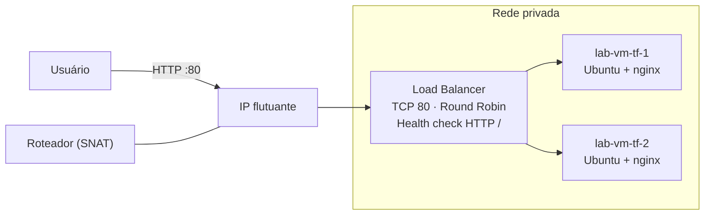
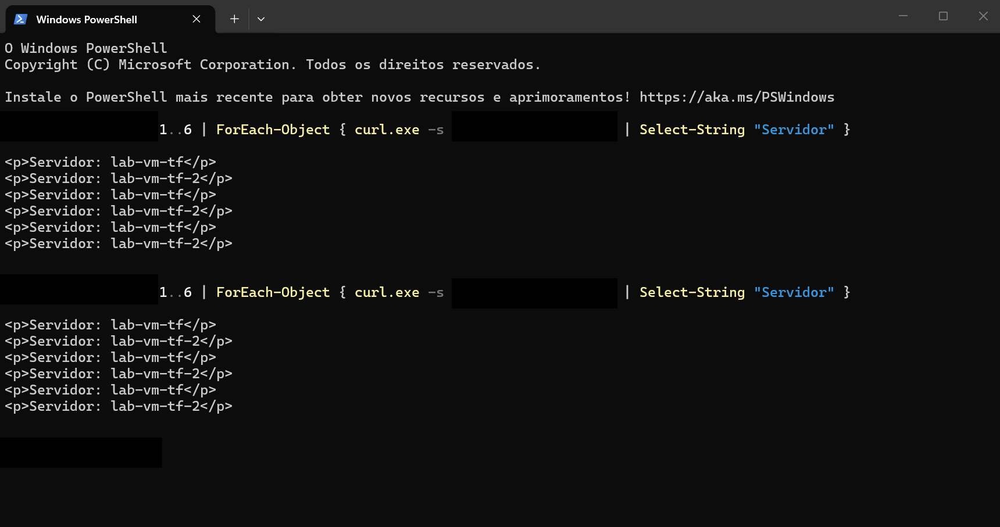
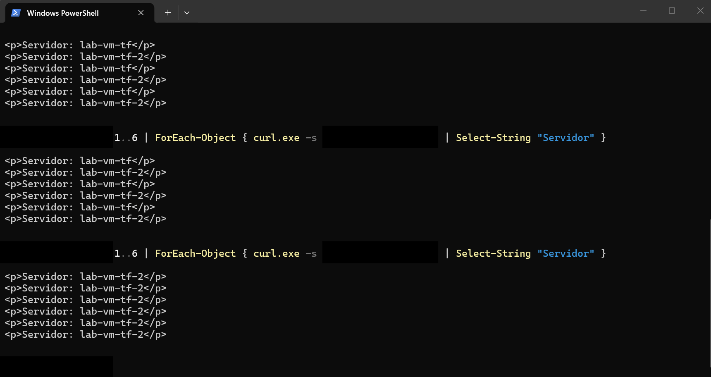

# Infraestrutura como código no Nuvion com Terraform

Projeto de estudo que provisiona, com um único `terraform apply`, uma pequena infraestrutura web de alta disponibilidade na nuvem [SaveinCloud (Nuvion)](https://docs.saveincloud.com/): duas VMs com nginx atrás de um load balancer, com rede, firewall e IP público. Um `terraform destroy` remove tudo.

O Nuvion é compatível com OpenStack, então o projeto usa o provider `terraform-provider-openstack/openstack`.

## Arquitetura



## O que o Terraform cria

| Recurso | Detalhe |
|---|---|
| Par de chaves SSH | Lê a chave pública de `~/.ssh/id_ed25519.pub` |
| 2 volumes de boot | 20 GiB, tipo `SSD Standard`, imagem Ubuntu 26.04 |
| 2 instâncias | Flavor `ST-1-0.5`, rede `Private`, nginx instalado via cloud-init |
| Security group | SSH liberado só para o meu IP, HTTP aberto |
| Roteador + interface | Liga a rede privada à rede externa (`public`) |
| IP flutuante | Associado ao load balancer |
| Load balancer | Listener TCP 80, pool Round Robin, health monitor HTTP em `/` (intervalo 5 s, 3 falhas) |

## Estrutura do repositório

```
.
├── provider.tf          # Provider OpenStack e credenciais
├── 00-variables.tf      # Variáveis
├── ssh-keypair.tf       # Par de chaves SSH
├── instance.tf          # Volumes e VMs (count = vm_count)
├── network.tf           # Security group, roteador e IP flutuante
├── lb.tf                # Load balancer, listener, pool, monitor e membros
├── outputs.tf           # IP público e URL do site
├── cloud-init.yaml      # Instala o nginx e gera a página inicial
└── terraform.tfvars     # NÃO versionado: credenciais e IP de acesso
```

## Pré-requisitos

- Terraform (testado com a versão 1.17.1)
- Conta no Nuvion com credenciais de aplicação OpenStack (`My Account > OpenStack Credentials`)
- Chave SSH `ed25519` em `~/.ssh/id_ed25519.pub`

## Como usar

1. Clone o repositório e entre na pasta.
2. Gere as credenciais no painel e crie o `terraform.tfvars` (este arquivo está no `.gitignore`):

   ```hcl
   application_credential_id     = "<credentials-id>"
   application_credential_secret = "<credentials-secret>"
   os_auth_url                   = "<server-url>"
   os_region                     = "RegionOne"
   meu_ip_cidr                   = "<seu-ip-publico>/32"
   ```

3. Provisione:

   ```
   terraform init
   terraform plan
   terraform apply
   ```

4. Pegue o endereço do site:

   ```
   terraform output site_url
   ```

5. Ao terminar, remova tudo para não gastar crédito:

   ```
   terraform destroy
   ```

## Teste de balanceamento e de falha

Aguarde 2 a 3 minutos para o cloud-init terminar e rode várias requisições seguidas (no PowerShell, use `curl.exe`):

```
1..6 | ForEach-Object { curl.exe -s http://<ip-publico> | Select-String "Servidor" }
```

As respostas alternam entre as duas VMs (Round Robin):



Depois desliguei uma das VMs pelo painel. Em poucos segundos o health monitor a tirou do pool, e todas as respostas passaram a vir da VM restante, sem erro para o cliente:



## Desafios e aprendizados

- **Cota de disco zerada (HTTP 413).** O primeiro `apply` falhou com `VolumeSizeExceedsAvailableQuota`. A cota existia só para o tipo de volume `SSD Standard`, e o Terraform usava o tipo padrão. Solução: definir `volume_type = "SSD Standard"`.
- **IP flutuante sem roteador (`ExternalGatewayForFloatingIPNotFound`).** Sem um roteador ligando a rede privada à externa, o IP flutuante não pode ser associado. Solução: criar o roteador e a interface na sub-rede pelo Terraform.
- **IP público no balanceador, não nas VMs.** O IP flutuante é associado à porta VIP do load balancer, e as VMs ficam sem IP público (acesso só pelo console do painel).
- **Regras de encaminhamento.** A documentação lista HTTPS→HTTPS, HTTPS→HTTP, TCP→TCP e UDP→UDP, sem HTTP→HTTP. Usei TCP 80 com um health monitor HTTP em `/`.
- **Segredos fora do Git.** `terraform.tfvars`, `*.tfstate` e `.terraform/` ficam no `.gitignore`. As credenciais foram geradas com data de expiração.

## Limitações

- State local (sem backend remoto).
- Flavor mínimo (1 vCPU, 512 MiB), suficiente só para laboratório.
- Load balancer sem HA (modo Single) para reduzir custo.

## Custo

- Operação total com o Nuvion: R$ 0.70
- Instâncias Virtuais(VMs): R$ 0.33
- Volume de armazenamento: R$ 0.04
- Endereços IPv4 flutuantes: R$ 0.08
- Load Balancers: R$ 0.21

## Próximos passos

- Pipeline de CI/CD com escaneamento de segurança (Trivy) fazendo deploy nessa infraestrutura
- Backup no Storin (S3) e teste de recuperação com `destroy` + `apply`
- Hardening das VMs com Ansible